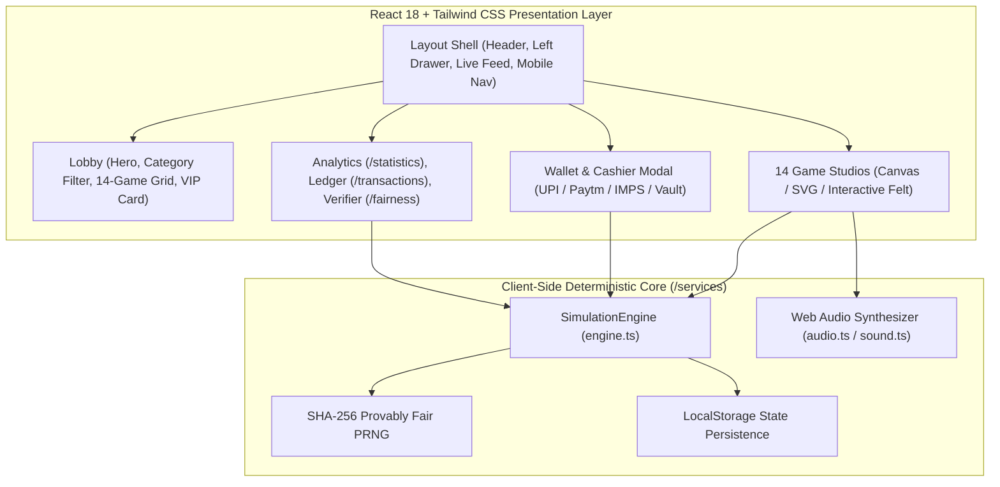

# 👑 Maharaja Club · Indian Online Casino, Instant INR Originals & Provably Fair Gaming Engine

<div align="center">


**A modern, full-featured Indian Online Casino & Provably Fair Game Mathematics Platform built with React 18, TypeScript, HTML5 Canvas, and Web Audio.**

[Explore the 14 Games](#-complete-14-game-portfolio--mathematical-models) • [Architecture](#-system-architecture) • [Provably Fair Spec](#-provably-fair-sha-256-verification-protocol) • [Quick Start](#-getting-started)

</div>

---

## 📖 Overview

**Maharaja Club** is an open-source, zero-backend casino platform and game-mathematics simulator tailored for the Indian market (`₹` INR currency formatting, simulated Instant UPI / Paytm / IMPS banking with 12-digit UTR references, and iconic Indian table & draw games alongside global crypto-casino originals).

Every interface uses **universal, accessible English terminology** paired with an authentic royal obsidian, 24K gold, and emerald studio aesthetic, responsive mobile-first ergonomics, custom vector illustrations, and a zero-dependency Web Audio sound synthesizer.

> **⚠️ Educational & Simulation Notice:** This repository is a **100% client-side virtual simulation** designed for frontend architecture, probability modeling, and provably fair cryptographic verification research. No real money, actual financial transactions, or real-world wagers are accepted or processed.

---

## ✨ Key Platform Capabilities

### 🎯 1. 14 Playable Games (Originals, Indian Classics & VIP Tables)
- **Featured High-Velocity Originals:**
  - **Aviator Crash (`/crash`)**: 60fps HTML5 Canvas flight trajectory, dynamic multiplier curve up to `10,000×`, Auto Cash-Out, Auto-Bet loop, and live multi-player cashout feed.
  - **Gold Mines (`/mines`)**: `5×5` grid with `1–24` configurable mines, custom 24K Gold Gem & Mine Bomb SVGs, live Multiplier Step Ladder, Manual tile reveal, and instant **Auto-Pick** mode.
  - **Plinko 1000× (`/plinko`)**: High-DPI (`devicePixelRatio`) Galton pin pyramid with `8`, `12`, or `16` rows, `Low / Medium / High` volatility buckets, and 5-ball burst drops.
  - **European Roulette (`/roulette`)**: Animated 37-pocket single-zero SVG wheel paired with an interactive betting felt (`Straight 36×`, `Dozen 3×`, `Column 3×`, and `1:1 Outside Bets`).
- **Signature Indian Classics (Standard English UI):**
  - **Kalyan Matka (`/matka`)**: Instant 3-card number draw supporting **Single Digit (0–9, `9.5×`)**, **Double Digit Pair (00–99, `95×`)**, **3-Card Combo (`150×–600×`)**, and **Even / Odd (`1.95×`)**.
  - **Teen Patti Royal (`/teenpatti`)**: 3-card Indian poker featuring **Seen Hand (`1.95×`)** and **Blind Hand (`2.10×`)** modes plus bonus multipliers up to `5.00×` for Three of a Kind and Straight Flushes.
  - **Andar Bahar Live (`/andarbahar`)**: Alternating **Inside (Andar `1.90×`)** and **Outside (Bahar `2.00×`)** card dealing against a central Target Joker card, plus a **Fast Match (Cards 1–3, `3.5×`)** side bet.
- **VIP Casino Tables & Instant Lotteries:**
  - **Blackjack 21 (`/blackjack`)**: 4-deck shoe, `3:2` Natural Blackjack (`2.5×`), Hit, Stand, and Double Down.
  - **Royal Baccarat (`/baccarat`)**: Punto Banco rules (`Player 2.00×`, `Banker 1.95×`, `Tie 9.00×` with Tie Push refund) and live Shoe Bead Road tracker.
  - **Maharaja Gold Slots (`/slots`)**: `3×3` 5-payline cabinet with horizontal and diagonal multiplier lines.
  - **Fortune Wheel (`/wheel`)**: 12-segment spoked SVG wheel with multipliers up to `30×`.
  - **Keno 40 (`/keno`)**: 40-number lottery board with up to 10 picks and `1,000×` max payout.
  - **Classic Dice (`/dice`)**: Precision `0.00–100.00` Roll Over / Roll Under probability slider (`99% RTP`).
  - **Coin Flip (`/coinflip`)**: 50/50 Heads or Tails instant toss with live win-streak counter (`1.98×`).

### 💳 2. Instant INR Cashier, Vault & VIP Rewards
- **Simulated Indian Payment Rails**: Instant deposits and withdrawals via **UPI (GPay / PhonePe)**, **Paytm Wallet**, and **IMPS Bank Transfer**, generating realistic 12-digit UTR reference numbers (`UTR #4XXXXXXXXXXX`).
- **Interest-Bearing Vault**: Lock profits away from your active playing balance at any time via the **Vault** tab in the cashier modal.
- **5-Tier VIP Rakeback Program**: Automatically earn instant rakeback from **Bronze (`0.75%`)** up to **Diamond (`2.00%`)** on every wager, claimable with one click.

### 🔐 3. Provably Fair SHA-256 Engine & Interactive Verifier (`/fairness`)
- Deterministic outcome generation using `SHA-256(serverSeed : clientSeed : nonce : cursor)`.
- Built-in **Interactive Outcome Verifier** on `/fairness` to inspect the exact SHA-256 digest, normalized float `r ∈ [0, 1)`, and resulting game outcomes for any seed combination.

---

## 📊 Complete 14-Game Portfolio & Mathematical Models

| Game Title | Route | Category | RTP | House Edge | Max Win | Mathematical Model |
| :--- | :--- | :--- | :---: | :---: | :---: | :--- |
| **Aviator Crash** | `/crash` | Originals | `99.0%` | `1.0%` | `10,000×` | Inverse uniform distribution `M = 0.99 / (1 - r)` |
| **Gold Mines** | `/mines` | Originals | `99.0%` | `1.0%` | `24.75×+` | Hypergeometric combinatorics `0.99 / P(k safe picks)` |
| **Plinko** | `/plinko` | Originals | `99.0%` | `1.0%` | `1,000×` | Binomial `B(N, 0.5)` trajectory across `8 / 12 / 16` rows |
| **European Roulette** | `/roulette` | Table | `97.3%` | `2.7%` | `36×` | Single-zero (`0–36`) uniform discrete distribution |
| **Kalyan Matka** | `/matka` | Indian Draw | `95.0%` | `5.0%` | `600×` | 3-card modulo-10 sum (`Single 9.5×`, `Double 95×`, `Combo 150×–600×`) |
| **Teen Patti** | `/teenpatti` | Indian Cards | `97.5%` | `2.5%` | `5.00×` | 52-card 3-card poker hand ranker (`Seen` & `Blind` multipliers) |
| **Andar Bahar** | `/andarbahar` | Indian Cards | `98.0%` | `2.0%` | `3.50×` | Alternating shoe deal until rank matches Target Card |
| **Blackjack 21** | `/blackjack` | Table | `99.5%` | `0.5%` | `2.50×` | 4-deck shoe, dealer stands on all `17`s, `3:2` Blackjack |
| **Royal Baccarat** | `/baccarat` | Table | `98.94%` | `1.06%` | `9.00×` | Punto Banco modulo-10 hand total & 3rd-card draw rules |
| **Gold Slots** | `/slots` | Slots | `97.0%` | `3.0%` | `250×` | `3×3` reel matrix evaluated across 3 rows + 2 diagonals |
| **Fortune Wheel** | `/wheel` | Originals | `99.0%` | `1.0%` | `30×` | 12-segment weighted angular distribution |
| **Keno 40** | `/keno` | Lottery | `99.0%` | `1.0%` | `1,000×` | 10-number sample without replacement from `1..40` |
| **Classic Dice** | `/dice` | Originals | `99.0%` | `1.0%` | `49.5×` | Continuous uniform roll `r × 100` with `M = 99 / WinChance` |
| **Coin Flip** | `/coinflip` | Originals | `99.0%` | `1.0%` | `1.98×` | Bernoulli trial `p = 0.50` paying `1.98×` |

---

## 🏗️ System Architecture



---

## 📁 Project Structure

```text
├── .github/workflows/
│   └── main.yml               # Automated GitHub Pages CI/CD build & deployment workflow
├── components/
│   ├── GameArtwork.tsx        # Custom bespoke SVG vector posters for all 14 games
│   ├── Layout.tsx             # Responsive shell, navigation sidebar, context bar & INR Cashier Modal
│   ├── Leaderboard.tsx        # Live Bets feed, My Bets history & VIP Leaderboard table
│   └── LiveFeed.tsx           # Collapsible right-hand Live Bets stream & VIP Player Chat
├── pages/
│   ├── Lobby.tsx              # Casino lobby with category filters, search, VIP summary & quick Matka draw
│   ├── Crash.tsx              # Aviator Crash (60fps HTML5 Canvas curve, Auto-Bet & Auto Cash-Out)
│   ├── Mines.tsx              # Gold Mines (5×5 grid, custom SVG gems/bombs, Manual & Auto-Pick modes)
│   ├── Plinko.tsx             # Plinko (High-DPI Canvas pin pyramid, 8/12/16 rows & Low/Med/High risk)
│   ├── Roulette.tsx           # European Roulette (Animated 37-pocket SVG wheel & full betting felt)
│   ├── Matka.tsx              # Kalyan Matka (Single Digit, Double Digit, 3-Card Combo & Even/Odd)
│   ├── TeenPatti.tsx          # Teen Patti (Seen & Blind hand modes + bonus hand multipliers)
│   ├── AndarBahar.tsx         # Andar Bahar (Inside/Outside lanes + Fast Match 1–3 bonus)
│   ├── Blackjack.tsx          # Blackjack 21 (4-deck shoe, Hit, Stand, Double Down)
│   ├── Baccarat.tsx           # Royal Baccarat (Player/Banker/Tie + Shoe Bead Road tracker)
│   ├── Slots.tsx              # Maharaja Gold Slots (3×3 reels, 5 paylines)
│   ├── Wheel.tsx              # Fortune Wheel (12-segment SVG spoked multiplier wheel)
│   ├── Keno.tsx               # Keno 40 (40-number grid, Auto-Pick & dynamic hit ladder)
│   ├── Dice.tsx               # Classic Dice (0–100 Roll Over / Under slider)
│   ├── Coinflip.tsx           # Coin Flip (Heads/Tails 50/50 toss with streak counter)
│   ├── Fairness.tsx           # Provably Fair seed rotator & interactive outcome calculator
│   ├── Statistics.tsx         # Session analytics, per-game realized RTP & bet history
│   ├── Transactions.tsx       # Wallet & Vault ledger with 12-digit UTR references
│   └── Admin.tsx              # House Sandbox for instant INR test credits & bankroll resets
├── services/
│   ├── engine.ts              # Deterministic SHA-256 game engine, VIP calculator & session manager
│   ├── audio.ts               # Zero-dependency Web Audio API sound effects synthesizer
│   └── sound.ts               # Ergonomic sound trigger helpers
├── App.tsx                    # HashRouter configuration & self-healing ErrorBoundary
├── types.ts                   # Strict TypeScript interfaces, enums & house edge constants
├── index.css                  # Custom surface gradients, animations & responsive utilities
└── vite.config.ts             # Vite bundler configuration
```

---

## 🔐 Provably Fair SHA-256 Verification Protocol

Every game round is verifiable using a 3-tuple of `(serverSeed, clientSeed, nonce)`:

1. **Pre-Round Commitment**: Before you place a bet, the platform displays `serverSeedHash = SHA256(serverSeed)`.
2. **Deterministic Byte Stream**: For round `nonce` and cursor `c ∈ {0, 1, 2, ...}`, the engine computes:
   ```text
   digest = SHA256("${serverSeed}:${clientSeed}:${nonce}:${c}")
   r      = parseInt(digest.slice(0, 8), 16) / 2^32   // Uniform float in [0, 1)
   ```
3. **Client Seed Rotation & Audit**: Visiting `/fairness` and rotating your Client Seed reveals the previous unhashed `serverSeed` and loads it directly into the **Interactive Outcome Verifier** so you can audit any historical round.

---

## 🚀 Getting Started

### Prerequisites
- **Node.js** `>= 18.0.0`
- **npm** `>= 9.0.0` (or `bun` / `pnpm`)

### Local Development

```bash
# 1. Clone the repository
git clone https://github.com/Paidguy/casino.git
cd casino

# 2. Install dependencies
npm install

# 3. Start the development server at http://localhost:3000
npm run dev
```

### Type-Checking & Production Build

```bash
# Run TypeScript compiler verification
npm run typecheck

# Build production bundle into ./dist
npm run build

# Preview production build locally
npm run preview
```

---

## 📄 License

Distributed under the **MIT License** for educational, UI/UX engineering, and probability-simulation research.